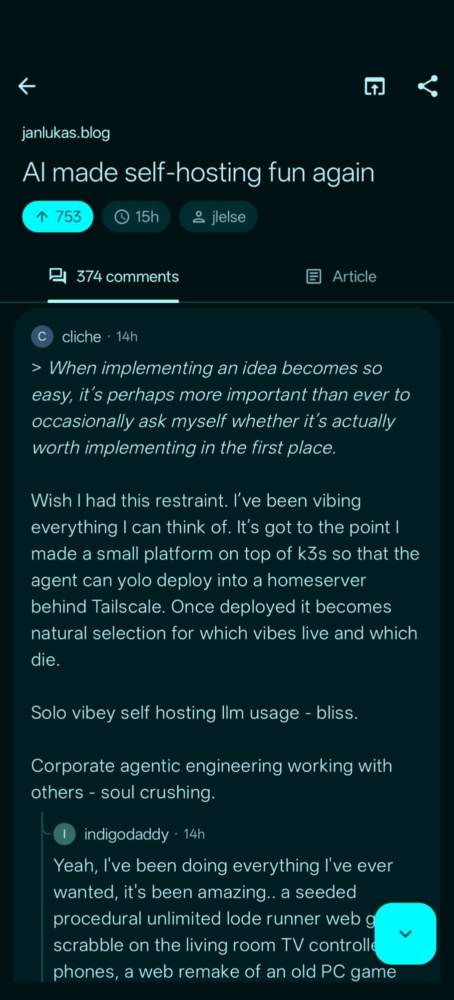

<h3>&nbsp; A fast, modern Hacker News reader for Android</h3>

[Latest release](https://github.com/ndom91/android-hn/releases/latest) ·
[Build status](https://github.com/ndom91/android-hn/actions/workflows/android.yml)

---

hn2 is a modern take on [Materialistic](https://github.com/hidroh/materialistic), which hasn't been
maintained since 2019. It keeps what made Materialistic great, a glanceable widget and a two-tab
article and comments view, and rebuilds everything else with Material You.

<table>
  <tr>
    <td align="center" width="33%"></td>
    <td align="center" width="33%"></td>
    <td align="center" width="33%"></td>
  </tr>
  <tr>
    <td align="center">Top stories on your home screen</td>
    <td align="center">Threaded comments</td>
    <td align="center">The article, one swipe away</td>
  </tr>
</table>

## Get started

1. On your Android phone, tap **[Download APK](https://github.com/ndom91/android-hn/releases/latest/download/hn2-debug.apk)**.
2. Open the downloaded file. The first time, Android asks you to allow installs from your browser.
3. Long-press your home screen, choose **Widgets** and add **HN stories**.

hn2 needs Android 8.0 or newer. A new build is published with every change; download it again the
same way and it updates in place.

## Features

- **Home-screen widget.** A resizable list of Top, Best, New, Ask, Show or Jobs stories, with
  points and comment counts that turn orange when a story is hot. It refreshes on its own every
  30 minutes, or with a tap on its refresh button. Long-press it to change the section or switch
  between dark, transparent and light themes.
- **Article and comments, side by side.** Tap a story to read the article in a full in-app
  browser, then swipe or tap over to the comments.
- **Readable comment threads.** Replies hang off thread lines so you can see who answered whom,
  and each author gets a colored avatar so you can follow them through a thread. Tap a comment to
  collapse it, or use the arrow button to jump to the next thread.
- **Material You.** The app picks up your wallpaper colors and follows light and dark mode.
- **HN links open in the app.** `news.ycombinator.com/item?id=…` links can open straight in hn2.

hn2 is read-only for now. Logging in, voting and replying are planned.

## Privacy

Stories come from the official [Hacker News API](https://github.com/HackerNews/API) and comments
from [Algolia's HN Search API](https://hn.algolia.com/api). hn2 has no account, server or
analytics of its own.

## Contributing

Build instructions, project layout and conventions are in [AGENTS.md](AGENTS.md).
