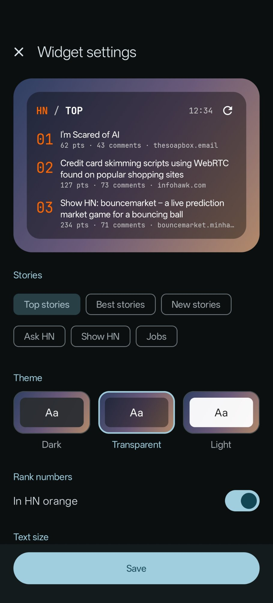
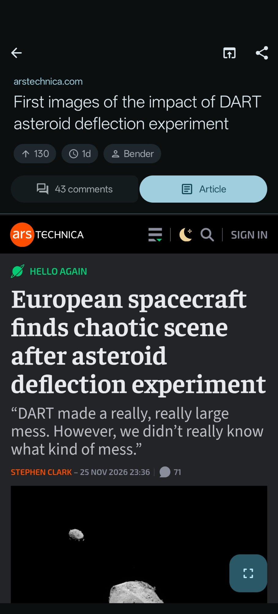

<h3>&nbsp; A fast, modern Hacker News reader for Android</h3>

---

hn2 is a modern take on [Materialistic](https://github.com/hidroh/materialistic), which hasn't been
maintained since 2019. It keeps what made Materialistic great, a glanceable widget and a two-tab
article and comments view, and rebuilds everything else with Material You. Like other Material You
apps, hn2 uses the color palette Android generates from your wallpaper (Android 12+), so on your
phone it probably won't be the cyan shown in these screenshots.

<table>
  <tr>
    <td align="center" width="25%"></td>
    <td align="center" width="25%"></td>
    <td align="center" width="25%"></td>
    <td align="center" width="25%"></td>
  </tr>
  <tr>
    <td align="center" valign="middle">Top stories on your home screen</td>
    <td align="center" valign="middle">Make the widget your own</td>
    <td align="center" valign="middle">Threaded comments</td>
    <td align="center" valign="middle">The article, one swipe away</td>
  </tr>
</table>

## Get started

1. On your Android phone, tap **[Download APK](https://github.com/ndom91/android-hn/releases/latest/download/hn2-debug.apk)**.
2. Open the downloaded file. The first time, Android asks you to allow installs from your browser.
3. Long-press your home screen, choose **Widgets** and add **HN stories**.

hn2 needs Android 8.0 or newer. A new build is published with every change; download it again the
same way and it updates in place.

## Features

- **Home-screen widget.** A resizable, ranked list of Top, Best, New, Ask, Show or Jobs stories,
  with points, comment counts and each link's site. It refreshes on its own every
  30 minutes, or with a tap on its refresh button. Long-press it to change the section, switch
  between dark, transparent and light themes, pick its text size and spacing, or color the rank numbers HN orange.
- **Article and comments, side by side.** Tap a story to read the article in a full in-app
  browser, then swipe or tap over to the comments.
- **Readable comment threads.** Replies hang off thread lines so you can see who answered whom,
  and each author gets a colored avatar so you can follow them through a thread. Tap a comment to
  collapse it, or use the arrow button to jump to the next thread.
- **Vote and comment.** Log in with your HN account from the account button on the story list.
  Tap a story's score to upvote it, long-press a comment to upvote or reply to it, or use
  the comment button above the next-thread button.
- **Material You.** The app picks up your wallpaper colors and follows light and dark mode.
- **HN links open in the app.** `news.ycombinator.com/item?id=…` links can open straight in hn2.

## Privacy

Stories come from the official [Hacker News API](https://github.com/HackerNews/API) and comments
from [Algolia's HN Search API](https://hn.algolia.com/api). hn2 has no account, server or
analytics of its own.

When you log in, your username and password go only to news.ycombinator.com, the same as logging
in on the website. hn2 doesn't store your password; it keeps HN's login cookie on your phone, in
storage only hn2 can read and that isn't included in Android backups. Log out from the account
button to delete it.

## Contributing

Build instructions, project layout and conventions are in [AGENTS.md](AGENTS.md).
